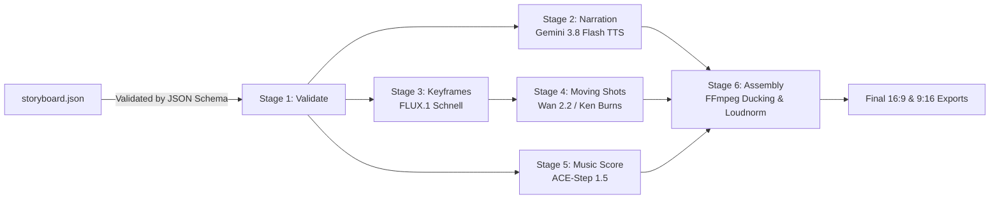

# ARCHITECTURE.md — Pipeline Architecture & Technical Contracts

## 1. System Overview & Stage Boundaries
The pipeline operates as a modular, deterministic state machine orchestrated by `run_pipeline.py`. The single source of truth across all stages is `storyboard.json`, strictly validated by `schema/storyboard.schema.json`.

---

## 2. Data Contracts
* **Contract Specification:** `schema/storyboard.schema.json` defines all required shot attributes: `shot_id`, `duration_seconds`, `reason`, `narration`, `image_prompt`, `motion_prompt`, `music_cue`.
* **Immutability Principle:** Upstream stages cannot alter the storyboard contract. Downstream stages consume only the declared fields and outputs of previous stages.

---

## 3. Caching & Deterministic Re-runs
To prevent burning GPU/API quotas and enable instantaneous re-runs, every generative stage implements content-addressable SHA-256 caching:

* **Narration Cache Key:** `SHA256(text + voice_instruction + language)`
* **Keyframe Cache Key:** `SHA256(prompt + negative_prompt + style_block + seed)`
* **Moving Shot Cache Key:** `SHA256(keyframe_bytes_hash + motion_prompt + duration + seed)`
* **Music Cache Key:** `SHA256(caption + tempo + key + duration + seed)`

*Behavior:* When a developer changes only `shot_03`'s prompt in `storyboard.json` and runs `python3 run_pipeline.py --stage all`, the pipeline detects cache hits for shots 1, 2, 4–9, regenerating **only** `shot_03`. This fulfills the live demonstration requirement for Assignment 2.

---

## 4. Failure Handling & Offline Fallbacks
The pipeline is designed to execute successfully from a clean clone even when external cloud services are offline or unconfigured:

1. **Gemini TTS Failure / Offline:** If `GEMINI_API_KEY` is unavailable or rate-limited, the system falls back to macOS native `say` or procedural audio waveform synthesis matching shot duration.
2. **Cloudflare AI Workers FLUX Failure:** If Cloudflare quotas are exhausted, the procedural cinematic renderer generates formatted keyframes preserving prompt metadata.
3. **Wan 2.2 GPU Ingestion vs Ken Burns Pan-and-Zoom:**
   - If Kaggle/Colab GPU outputs exist in `outputs/wan_drops/`, the pipeline seamlessly ingests them.
   - If offline or on CPU, the built-in FFmpeg Ken Burns module applies smooth 24fps pan-and-zoom motion matching the storyboard camera prompts.
4. **Assembly Audio Ducking & Loudnorm:**
   - Uses FFmpeg's `sidechaincompress` filter (`threshold=0.02, ratio=6, attack=300ms, release=1500ms`) to duck score dynamically under speech.
   - Normalizes audio to broadcast standard **-14 LUFS (EBU R128)** with **-1.0 dB true peak** to avoid platform distortion.

---

## 5. Configuration & Endpoint Decoupling
All external API URLs are completely abstracted out of the code and defined as environment templates in `.env`:
* **`GEMINI_URL`:** Parameterized model template (`.../models/{model_name}:generateContent`) supporting dynamic fallback across `gemini-flash-lite`, `gemini-3.8-flash`, and TTS preview endpoints.
* **`CLOUDFLARE_FLUX_URL`:** Parameterized account template (`.../accounts/{account_id}/ai/run/@cf/black-forest-labs/flux-1-schnell`).
* **`KAGGLE_API_URL`:** Base endpoint for remote dataset and GPU execution.

*Benefit:* Eliminates hardcoded URLs, facilitates switching between cloud regions or local proxies, and adheres strictly to Twelve-Factor App config separation.

