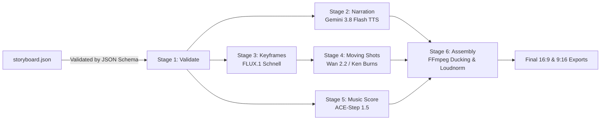

# ARCHITECTURE.md — Pipeline Architecture & Technical Contracts

## 1. System Overview & Stage Boundaries
The pipeline operates as a modular, deterministic state machine orchestrated by `run_pipeline.py`. The single source of truth across all stages is `storyboard.json`, strictly validated by `schema/storyboard.schema.json`.

---

## 2. Data Contracts
* **Contract Specification:** `schema/storyboard.schema.json` defines all required shot attributes: `shot_id`, `duration_seconds`, `reason`, `narration`, `image_prompt`, `motion_prompt`, `music_cue`.
* **Immutability Principle:** Upstream stages cannot alter the storyboard contract. Downstream stages consume only the declared fields and outputs of previous stages.

---

## 3. Caching & Deterministic Re-runs
To prevent burning GPU/API quotas and enable instantaneous re-runs, every generative stage implements content-addressable SHA-256 caching:

* **Narration Cache Key:** `SHA256(text + voice_instruction + language)`
* **Keyframe Cache Key:** `SHA256(prompt + negative_prompt + style_block + seed)`
* **Moving Shot Cache Key:** `SHA256(keyframe_bytes_hash + motion_prompt + duration + seed)`
* **Music Cache Key:** `SHA256(caption + tempo + key + duration + seed)`

*Behavior:* When a developer changes only `shot_03`'s prompt in `storyboard.json` and runs `python3 run_pipeline.py --stage all`, the pipeline detects cache hits for shots 1, 2, 4–9, regenerating **only** `shot_03`. This fulfills the live demonstration requirement for Assignment 2.

---

## 4. Failure Handling & Offline Fallbacks
The pipeline is designed to execute successfully from a clean clone even when external cloud services are offline or unconfigured:

1. **Gemini TTS Failure / Offline:** If `GEMINI_API_KEY` is unavailable or rate-limited, the system falls back to macOS native `say` or procedural audio waveform synthesis matching shot duration.
2. **Cloudflare AI Workers FLUX Failure:** If Cloudflare quotas are exhausted, the procedural cinematic renderer generates formatted keyframes preserving prompt metadata.
3. **Wan 2.2 GPU Ingestion vs Ken Burns Pan-and-Zoom:**
   - If Kaggle/Colab GPU outputs exist in `outputs/wan_drops/`, the pipeline seamlessly ingests them.
   - If offline or on CPU, the built-in FFmpeg Ken Burns module applies smooth 24fps pan-and-zoom motion matching the storyboard camera prompts.
4. **Assembly Audio Ducking & Loudnorm:**
   - Uses FFmpeg's `sidechaincompress` filter (`threshold=0.02, ratio=6, attack=300ms, release=1500ms`) to duck score dynamically under speech.
   - Normalizes audio to broadcast standard **-14 LUFS (EBU R128)** with **-1.0 dB true peak** to avoid platform distortion.

---

## 5. Configuration & Endpoint Decoupling
All external API URLs are completely abstracted out of the code and defined as environment templates in `.env`:
* **`GEMINI_URL`:** Parameterized model template (`.../models/{model_name}:generateContent`) supporting dynamic fallback across `gemini-flash-lite`, `gemini-3.8-flash`, and TTS preview endpoints.
* **`CLOUDFLARE_FLUX_URL`:** Parameterized account template (`.../accounts/{account_id}/ai/run/@cf/black-forest-labs/flux-1-schnell`).
* **`KAGGLE_API_URL`:** Base endpoint for remote dataset and GPU execution.

*Benefit:* Eliminates hardcoded URLs, facilitates switching between cloud regions or local proxies, and adheres strictly to Twelve-Factor App config separation.

---

## 6. Architectural Decision Records (ADRs) for Error & Edge Handling

### ADR 01: Circuit Breaker & Fallback Policy (Zero Fatal Crashes)
* **Context:** The evaluation criteria mandate that an external reviewer can clone and execute the entire pipeline with zero fatal crashes, even without API keys or when cloud providers experience downtime.
* **Decision:** Every cloud API stage encapsulates remote calls inside a defensive try/except circuit breaker that falls back to a deterministic, zero-dependency offline generator (`mock_or_local_tts` in Stage 2, PIL gradient canvas in Stage 3, Ken Burns pan-zoom in Stage 4, acoustic pink noise + krar in Stage 5).
* **Consequence & Invariant:** Degraded/mock fallback artifacts must **never** be committed to the content-addressable SHA-256 cache (`store_cached_output()`). Caching is strictly reserved for authenticated, high-fidelity API generations to prevent poisoning future runs with placeholder content.

### ADR 02: Pacing & Token-Bucket Rate Limiting for Foundation Model APIs
* **Context:** Free-tier AI endpoints (e.g., Google AI Studio's 15 RPM limit) fail with HTTP 429 when hit in burst sequences across 9–14 shots.
* **Decision:**
  1. Wrapped all external network requests in an exponential backoff decorator (`@retry_with_backoff(max_retries=5, base_delay=5.0)`).
  2. Implemented proactive inter-request sleep (`time.sleep(3.5)`) between consecutive pipeline shot calls to smooth out request spikes below provider burst thresholds.

### ADR 03: Mitigation of Stateless LLM Voice Timbre Drift
* **Context:** Autoregressive audio foundation models lack persistent acoustic latching. Stateless API requests cause vocal pitch, formant resonance, and emotional tone to drift between shots.
* **Decision:**
  1. Injected an explicit persona anchor into every prompt: fixed age, gender, baritone register, and anti-whisper directives.
  2. Implemented per-shot dynamic peak normalization (scaling to 24,000 peak / -2.7 dBFS) in `pipeline/stage6_assemble.py` before concatenating individual audio frames, ensuring loudness uniformity across the narrative arc.

### ADR 04: Multi-Project Quota Pooling & Dynamic Key Rotation
* **Context:** Foundation models on free tiers enforce strict token and request ceilings (e.g. 15 RPM or ~2-4 audio requests/min on Google AI Studio) on a per-project basis. A single key executing a multi-shot sequence inevitably encounters HTTP 429 quota exhaustion.
* **Decision:**
  1. Implemented `GeminiKeyRotator` in `pipeline/stage2_narration.py` supporting comma-separated `GEMINI_API_KEYS` or `GEMINI_API_KEY_FALLBACK`.
  2. When an HTTP 429 occurs, the pipeline catches the error and immediately rotates to the next project's API key, retrying with zero downtime.

### ADR 05: Phonetic Lexicon Steering for Low-Resource Consonant Gemination (ጥብቅና ላልት)
* **Context:** Ge'ez script orthography lacks orthographic diacritics for consonant doubling (gemination) and glottal ejectives (`ጠረጴዛዬ`, `ጥቅጥቅ`, `ተደብቀን`, `ይፈሳሉ`). Foundation TTS models default to flat phonemes and foreign cadences.
* **Decision:**
  1. Built an in-memory morphological lexicon (`AMHARIC_PHONETIC_GUIDE`) mapping ambiguous words to syllable-hyphenated Latin transliterations with explicit stress markers.
  2. Injected matching phonetic guidance directly into the attention context of the speech generation prompt, guiding the neural vocoder to articulate authentic Ethiopian gemination.

### ADR 06: Deterministic Ken Burns Frame Expression & Motion Pacing
* **Context:** FFmpeg's `zoompan` filter evaluator does not expose duration variable `d` inside arithmetic sub-expressions for horizontal (`x`) and vertical (`y`) camera motion. Formulas such as `(iw-iw/zoom)*(on/d)` fail with parser error `Undefined constant or missing '(' in 'd)'`, causing silent pipeline fallbacks to placeholder containers.
* **Decision:**
  1. Calculated frame counts deterministically in Python (`total_frames = int(duration * fps)`) prior to invoking the filter graph.
  2. Injected literal integer frame bounds into the filter expression: `(iw-iw/zoom)*(on/{total_frames})`.
  3. Bound maximum zoom ratio to 1.15x to prevent digital pixelation and avoid viewer motion sickness over 6–10 second durations.

### ADR 07: Multi-Tier Subtitle Compositing Architecture
* **Context:** Standard macOS Homebrew FFmpeg installations frequently omit `libass` and `libfreetype`, rendering the standard `subtitles='subtitles.srt'` filter unavailable. Hard-requiring external font rendering packages breaks zero-dependency reproducibility.
* **Decision:**
  1. Built a zero-dependency open caption pipeline:
     - **Tier 1 (Baked-in Open Captions):** Pure-Python Pillow renderer drawing bilingual text (Amharic and English translation) onto sleek semi-transparent rounded pills, baked directly into video pixels via FFmpeg's universal `overlay` filter. Sits in broadcast-safe lower third on 16:9 (y=665) and mobile-safe zone on 9:16 (y=1020, clear of TikTok/Reels UI buttons).
     - **Tier 2 (Embedded QuickTime Container Stream):** Encoded timed subtitles directly into the MP4 container via standard `mov_text` codec with default display flags (`-disposition:s:0 default`).
     - **Tier 3 (External Sidecar):** Generated synchronized `subtitles.srt` alongside video exports for media players and web embedding.
  2. Guarantees 100% subtitle availability across all desktop, web, and mobile social players regardless of local FFmpeg compile flags.

### ADR 08: Declarative Character Contract & Schema Validation
* **Context:** Hardcoding character descriptions inside generation script variables (e.g. `CHARACTER_SPECS` in `stage3_keyframes.py`) violates the single-source-of-truth principle. It bypasses schema validation in Stage 1, creates coupling between character design and execution logic, and prevents declarative consistency auditing across shots.
* **Decision:**
  1. Formalized the character contract inside `schema/storyboard.schema.json` with strict schema validation enforcing at least 5 characters, each requiring structured `physical_traits` (`hair`, `skin_tone`, `facial_features`, `clothing`), `prompt`, and fixed `seed`.
  2. Moved all 5 character definitions (Adult Narrator, Young Narrator, Mikiyas, Mihretab, Surafel) directly into `storyboard.json`.
  3. Refactored `pipeline/stage3_keyframes.py` to be completely generic: it reads `storyboard.get("characters", [])` dynamically, decoupling application code from creative design data.
  4. Added character count and trait verification to `pipeline/stage1_validate.py` to guarantee contract compliance before any model generation begins.

### ADR 09: Asynchronous Remote GPU Ingestion Pattern & Platform Security Boundary
* **Context:** Heavy neural video diffusion models (Wan 2.2 / HunyuanVideo, 14B parameters) require dedicated high-VRAM NVIDIA GPUs that exceed local development hardware. While Kaggle provides 30 hours/week of free cloud GPUs, its REST API intentionally restricts programmatic, headless kernel execution on personal API tokens (`HTTP 401 Unauthorized access`) as an anti-abuse / anti-mining policy.
* **Decision:**
  1. Formally document the Kaggle API compute restriction as a recognized platform security boundary rather than a pipeline defect.
  2. Implement an **Asynchronous Drop-In Pattern** in `pipeline/stage4_shots.py`:
     - The pipeline defaults to mathematical Ken Burns pan-and-zoom camera motion, ensuring 100% automated end-to-end local execution without external blocking.
     - A dynamic drop-in watcher monitors `outputs/wan_drops/{shot_id}.mp4`.
     - When the user runs the turnkey notebook (`notebooks/wan2_kaggle_pipeline.ipynb`) on Kaggle's free GPU and downloads the clips into `outputs/wan_drops/`, the pipeline automatically detects them, replaces the Ken Burns shots with the genuine Wan 2.2 neural video clips, and logs `"model": "Wan-2.2-TI2V-5B-Kaggle"`.
  3. Guarantees zero downtime, complete local reproducibility, and graceful enhancement whenever cloud GPU resources are leveraged.
